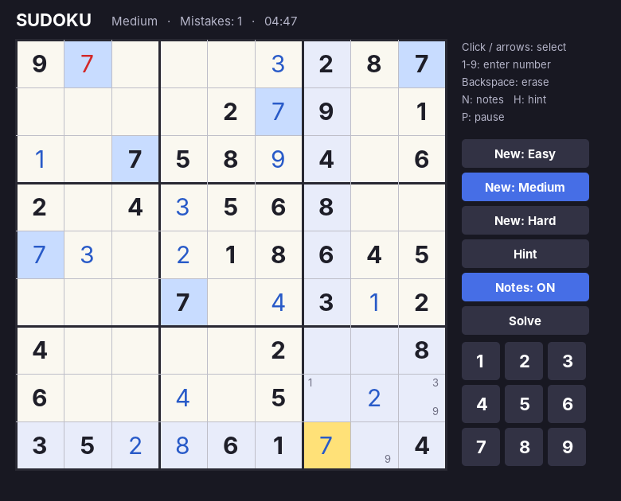
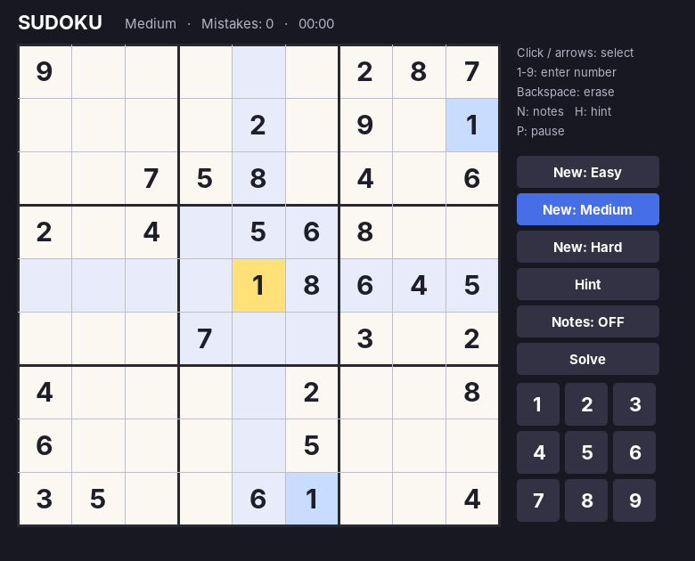
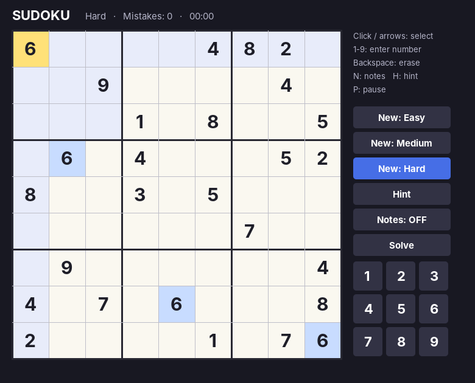
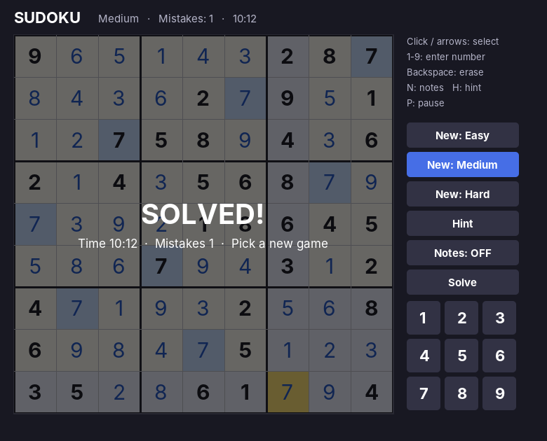

# Sudoku in Java

A Sudoku game written in plain Java with Swing. Every puzzle is generated fresh and has exactly one solution. It's one source file and needs no external libraries.



## Features

- A new random puzzle every game, at **Easy**, **Medium** or **Hard** difficulty
- Every puzzle is checked to have exactly one solution
- Instant feedback: a wrong number turns **red** and adds to your mistake count
- Highlights the selected cell's row, column and 3×3 box, and every cell with the same number
- **Notes mode** for pencil marks. Entering a correct number clears that number from the notes it affects.
- **Hint** fills in the correct value of the selected cell
- **Solve** reveals the whole solution
- A timer, a mistake counter and a pause screen
- Controls work with the mouse (number pad and buttons) or the keyboard

## Screenshots

| New puzzle | Playing (notes, mistake) | Hard puzzle | Solved |
|---|---|---|---|
|  |  |  |  |

## Controls

| Input | Action |
|---|---|
| Mouse click / Arrow keys | Select a cell |
| 1 – 9 (or on-screen pad) | Enter a number |
| Backspace / Delete / 0 | Erase the cell |
| N (or **Notes** button) | Turn notes mode on or off |
| H (or **Hint** button) | Fill in the selected cell |
| P | Pause / resume |
| **New: Easy / Medium / Hard** | Start a new puzzle |
| **Solve** | Show the solution |

## Difficulty

| Level | Empty cells |
|---|---|
| Easy | 36 |
| Medium | 46 |
| Hard | 54 |

## Requirements

- Java JDK 8 or newer. Check with `javac -version`.
  - macOS: `brew install openjdk`, or download it from [adoptium.net](https://adoptium.net)
  - Windows / Linux: download it from [adoptium.net](https://adoptium.net)

## How to run

### Option 1: Terminal (any OS)

```bash
git clone https://github.com/neerajR596/sudoku-java.git
cd sudoku-java
javac Sudoku.java
java Sudoku
```

### Option 2: Double-click (macOS)

Double-click `run-sudoku.command`. It compiles and launches the game.
If macOS says the file isn't executable, run `chmod +x run-sudoku.command` once.

### Option 3: IDE

Open the folder in IntelliJ IDEA, Eclipse or VS Code (with the Java Extension Pack), open `Sudoku.java`, and run `main`.

## Project structure

```
sudoku-java/
├── Sudoku.java          # The whole game: generator, input and rendering
├── run-sudoku.command   # macOS launcher that compiles and runs the game
├── screenshots/         # Images used in this README
└── README.md
```

## How it works

- **Generating the solution:** a backtracking solver fills an empty grid, trying the digits in random order, so every finished grid is different.
- **Making the puzzle:** cells are removed in random order. After each removal, a solver counts the solutions and stops at two. If removing a cell would allow more than one solution, the cell is put back. That's how every puzzle ends up with exactly one solution.
- **Checking moves:** each number you enter is compared with the stored solution, so mistakes show up straight away.
- **Rendering:** a custom `JPanel` draws the board, highlights, notes and side panel with `Graphics2D`. A Swing `Timer` runs the clock.

## Author

[@neerajR596](https://github.com/neerajR596)
